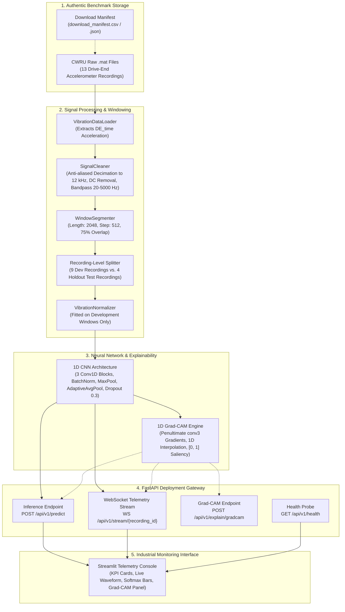
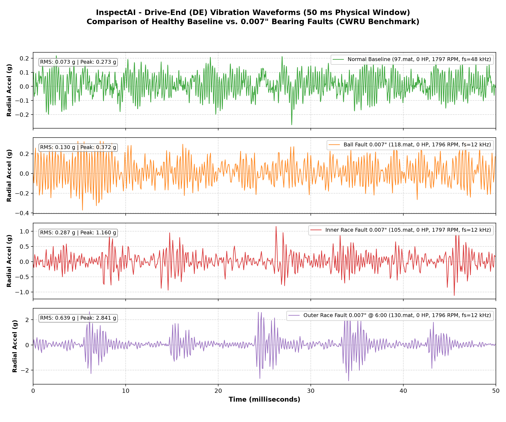
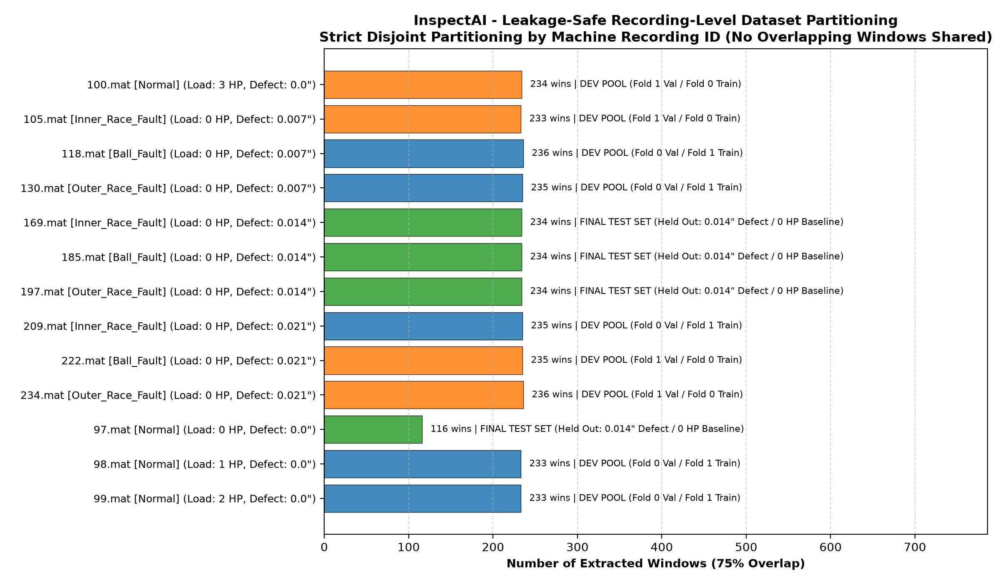
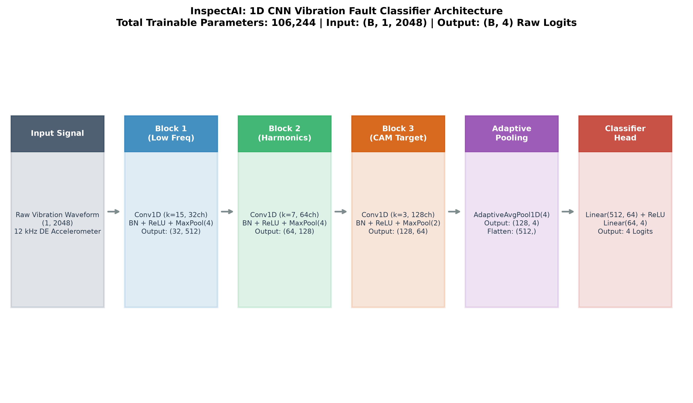
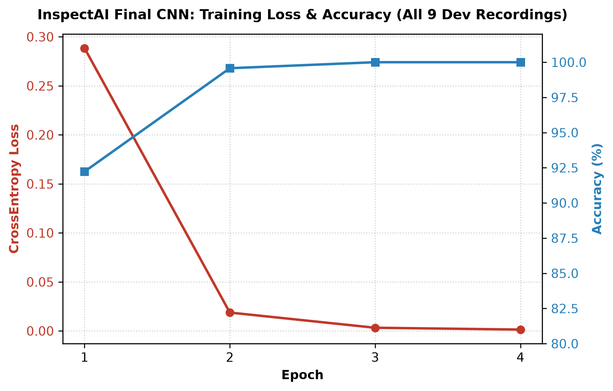
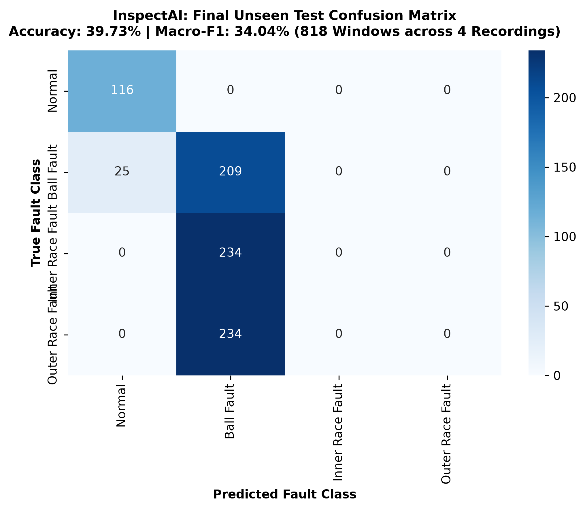
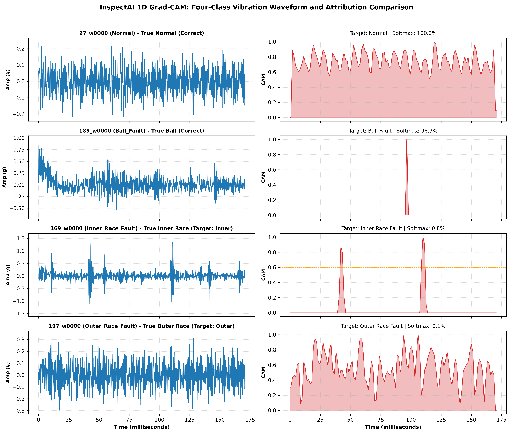
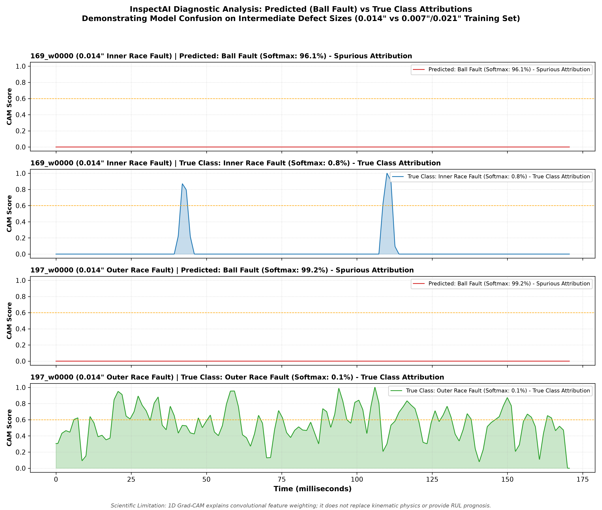

# InspectAI: Explainable Industrial Machine Health Monitoring System

[](https://www.python.org/)
[-EE4C2C.svg?logo=pytorch&logoColor=white)](https://pytorch.org/)
[](https://fastapi.tiangolo.com/)
[](https://streamlit.io/)
[](#7-1d-cnn-architecture)
[](#18-testing--automated-validation)

> **Important Operational & Safety Disclaimer**:  
> InspectAI is an applied research and engineering portfolio platform simulating continuous vibration monitoring from authentic laboratory benchmark recordings. It is **not** connected to physical motor hardware or live edge accelerometers. Furthermore, as documented under [Evaluation Results](#9-model-evaluation--empirical-findings), the current model exhibits significant domain sensitivity on out-of-distribution defect geometries and is **not** certified or recommended for production industrial safety decisions.

---

## 1. Project Introduction & Problem Statement

### The Industrial Problem
In modern manufacturing and energy infrastructure, rotating machinery—such as induction motors, centrifugal pumps, gearboxes, and industrial fans—operates under heavy continuous mechanical stress. Rolling element bearings represent the most common point of mechanical failure in rotating machinery, accounting for over 40% of all electric motor breakdowns. Unscheduled downtime caused by catastrophic bearing seizure costs heavy industry tens of billions of dollars annually in lost throughput and emergency repairs.

While vibration accelerometer analysis is the gold-standard diagnostic modality for detecting mechanical degradation, classical manual spectral analysis requires specialized vibration analysts. Deep learning models offer automated diagnostic classification directly from raw high-frequency waveforms. However, standard deep learning implementations in condition monitoring frequently suffer from two critical industry bottlenecks:
1. **Severe Data Leakage & Over-optimistic Benchmarks**: Randomly splitting overlapping sliding windows across train and test sets leads to massive data leakage, generating artificially inflated 99%+ accuracy reports that collapse completely when tested on unseen machines or recordings.
2. **Black-Box Opacity**: Maintenance engineers cannot safely take expensive machines offline based solely on uncalibrated neural network output logits without interpretable diagnostic evidence linking model decisions to physical fault dynamics.

### What InspectAI Does
**InspectAI** is an end-to-end, explainable machine learning engineering platform engineered to tackle both challenges directly:
- **Digital Signal Processing**: Implements polyphase anti-aliasing decimation (resampling 48 kHz normal baselines to 12 kHz), zero-mean DC offset removal, and 4th-order zero-phase Butterworth bandpass filtering ($20\text{ Hz} - 5,000\text{ Hz}$).
- **Leakage-Safe Segmentation**: Segments waveforms into 2,048-sample windows with 75% overlap, strictly isolated at the **recording level** (zero window or sample overlap between development and holdout partitions).
- **Edge-Optimized 1D CNN**: Employs a lightweight, 3-block 1D Convolutional Neural Network (73,156 parameters, ~292 KB) optimized for low-latency CPU inference (~4 ms per window).
- **1D Grad-CAM Explainability**: Generates one-dimensional Class Activation Maps from the penultimate convolutional layer (`conv3`), isolating temporal shock intervals and contrasting predicted vs. ground-truth saliency profiles.
- **FastAPI Telemetry Gateway**: Exposes low-latency REST endpoints (`POST /api/v1/predict`, `POST /api/v1/explain/gradcam`) and a real-time WebSocket stream (`WS /api/v1/stream/{recording_id}`) that replays authentic CWRU recordings chunk-by-chunk.
- **Streamlit Operator Console**: Provides a responsive industrial monitoring dashboard displaying live simulated waveforms, KPI summaries, uncalibrated softmax distribution bars, and on-demand Grad-CAM heatmaps.

---

## 2. System Architecture

The following diagram details the end-to-end architecture and data lifecycle across InspectAI:



---

## 3. Technology Stack

- **Deep Learning & Computing**: PyTorch (CPU wheel `2.2+`), NumPy, SciPy, Pandas, Scikit-learn
- **Backend Framework**: FastAPI `0.110+`, Uvicorn (ASGI), Pydantic v2, WebSockets
- **Frontend Dashboard**: Streamlit `1.32+`, Matplotlib (Agg backend)
- **Containerization**: Docker, Docker Compose (CPU multi-service setup)
- **Quality Assurance & Testing**: Pytest `8.0+`, HTTPX, Flake8, Black
- **Signal Processing**: Polyphase resampler, 4th-order forward-backward zero-phase Butterworth filter

---

## 4. Dataset: Case Western Reserve University (CWRU)

InspectAI is benchmarked on authentic vibration accelerometer data from the **[Case Western Reserve University Bearing Data Center](https://engineering.case.edu/bearingdatacenter/download-data-file)**.

### Experimental Test Rig Configuration
- **Drive-End (DE) Accelerometer**: Mounted at the 12 o'clock position on the drive-end housing of a 2 HP Reliance Electric induction motor.
- **Sampling Rates**: 12,000 samples/sec for fault recordings; 48,000 samples/sec for normal baseline recordings.
- **Motor Operating Conditions**: 0 HP (~1797 RPM), 1 HP (~1772 RPM), 2 HP (~1750 RPM), and 3 HP (~1730 RPM).
- **Bearing Type**: Deep groove ball bearing (SKF 6205-2RS JEM).
- **Defect Generation**: Single-point faults introduced via Electro-Discharge Machining (EDM) with fault diameters of $0.007''$, $0.014''$, and $0.021''$.

### The 13 Benchmark Recordings
| Recording ID | Defect Category | Defect Diameter | Motor Load | Shaft Speed | Nominal Sample Rate | Partition |
| :--- | :--- | :--- | :--- | :--- | :--- | :--- |
| `97.mat` | Normal Baseline | None | 0 HP | 1796 RPM | 48,000 Hz | **Holdout Test** |
| `98.mat` | Normal Baseline | None | 1 HP | 1772 RPM | 48,000 Hz | Development |
| `99.mat` | Normal Baseline | None | 2 HP | 1750 RPM | 48,000 Hz | Development |
| `100.mat` | Normal Baseline | None | 3 HP | 1730 RPM | 48,000 Hz | Development |
| `118.mat` | Ball Fault | 0.007" | 0 HP | 1796 RPM | 12,000 Hz | Development |
| `185.mat` | Ball Fault | 0.014" | 0 HP | 1796 RPM | 12,000 Hz | **Holdout Test** |
| `222.mat` | Ball Fault | 0.021" | 0 HP | 1796 RPM | 12,000 Hz | Development |
| `105.mat` | Inner Race Fault | 0.007" | 0 HP | 1796 RPM | 12,000 Hz | Development |
| `169.mat` | Inner Race Fault | 0.014" | 0 HP | 1796 RPM | 12,000 Hz | **Holdout Test** |
| `209.mat` | Inner Race Fault | 0.021" | 0 HP | 1796 RPM | 12,000 Hz | Development |
| `130.mat` | Outer Race Fault | 0.007" | 0 HP | 1796 RPM | 12,000 Hz | Development |
| `197.mat` | Outer Race Fault | 0.014" | 0 HP | 1796 RPM | 12,000 Hz | **Holdout Test** |
| `234.mat` | Outer Race Fault | 0.021" | 0 HP | 1796 RPM | 12,000 Hz | Development |

### Critical Dataset Limitations
1. **Single Physical Test Stand**: All 13 recordings originate from one experimental motor test rig in a controlled laboratory setting.
2. **Artificial EDM Notches**: Electro-discharge machined pit defects produce distinct impulsive shock waves that differ from gradual natural subsurface fatigue spalling and micro-cracking encountered in field machinery.
3. **Limited Operating Envelope**: Fault recordings are exclusively captured at 0 HP (~1797 RPM), whereas normal baseline recordings span 0 to 3 HP.
4. **Lack of Run-to-Failure Trajectories**: The dataset provides discrete steady-state condition snapshots rather than continuous lifetime degradation histories.

### How to Obtain the Dataset
The raw dataset can be acquired in two ways:
1. **Automated Downloader**: Execute `python notebooks/01_cwru_dataset_acquisition.py`. The script reads the verified checksums from `data/raw/cwru/download_manifest.csv` and downloads all 13 `.mat` files directly from the CWRU servers.
2. **Manual Download**: Download each recording directly from the [CWRU Bearing Data Center](https://engineering.case.edu/bearingdatacenter/download-data-file) and place the `.mat` files into `data/raw/cwru/`.

---

## 5. Signal Preprocessing & Window Segmentation

Raw accelerometer signals contain low-frequency structural vibration, high-frequency electromagnetic noise, and variable sampling frequencies. InspectAI applies a deterministic 3-stage conditioning pipeline:

1. **Polyphase Anti-Aliased Resampling**: Normal baseline recordings (`97`–`100`) sampled at 48,000 Hz are decimated by an integer factor of 4 to match the 12,000 Hz fault rate using an 8th-order Chebyshev Type I lowpass filter with zero phase distortion (`scipy.signal.resample_poly`).
2. **DC Bias Offset Subtraction**: Sensor gravity and electronic bias are eliminated by centering the signal to zero mean: $\tilde{x}[n] = x[n] - \mu_x$.
3. **Zero-Phase Bandpass Filtering**: A 4th-order forward-backward Butterworth filter passes frequencies between $20\text{ Hz}$ (attenuating low-frequency motor foundation sway) and $5,000\text{ Hz}$ (attenuating high-frequency transducer resonance and ambient electrical noise).

### Sliding Window Segmentation
Conditioned continuous signals are segmented into fixed temporal windows:
- **Window Length ($N$)**: 2,048 samples ($\approx 170.67\text{ ms}$ at 12 kHz). At 1796 RPM (~29.93 Hz shaft frequency), each window captures **5.11 full shaft revolutions**, ensuring complete periodic coverage of ball-pass defect impacts.
- **Hop Size ($S$)**: 512 samples ($\approx 42.67\text{ ms}$). This provides **75% overlap** between consecutive temporal windows, producing an aggregate yield of **2,928 total windows** across all 13 recordings.



---

## 6. Leakage-Safe Recording-Level Dataset Splitting

### The Danger of Window-Level Random Splitting
In condition monitoring literature, a prevalent flaw is randomly shuffling overlapping sliding windows into train and test sets. With 75% overlap, window $w_i$ and window $w_{i+1}$ share **1,536 identical physical samples**. If $w_i$ is placed in the training set and $w_{i+1}$ in the test set:
- The model memorizes exact sample patterns rather than generalizable defect dynamics.
- Reported test accuracy artificially exceeds 99%.
- The model fails completely when deployed on an unseen machine.

### InspectAI Recording-Level Partitioning Strategy
InspectAI enforces a strict, group-aware **recording-level split**: all overlapping windows from a given recording belong exclusively to one partition.



- **Development Partition (9 recordings, 2,110 windows)**:
  - Normal: `98`, `99`, `100` (1, 2, 3 HP)
  - Ball Fault: `118` (0.007"), `222` (0.021")
  - Inner Race Fault: `105` (0.007"), `209` (0.021")
  - Outer Race Fault: `130` (0.007"), `234` (0.021")
  - *Usage*: Parameter estimation for `VibrationNormalizer`, two-fold cross-validation, and final development training.
- **Holdout Test Partition (4 recordings, 818 windows)**:
  - Normal: `97` (0 HP baseline)
  - Ball Fault: `185` (0.014" intermediate defect)
  - Inner Race Fault: `169` (0.014" intermediate defect)
  - Outer Race Fault: `197` (0.014" intermediate defect)
  - *Usage*: Held strictly untouched until final holdout evaluation.

---

## 7. 1D CNN Architecture

InspectAI deploys `VibrationCNN1D`, a 1D Convolutional Neural Network designed specifically for fast, accurate time-series feature extraction without the latency overhead of 2D spectrogram transforms:



### Layer Dimensions & Specification
- **Input Dimension**: $(B, 1, 2048)$
- **Block 1 (Low-level wave transients)**:
  - $\text{Conv1D}(1 \to 32, \text{kernel}=15, \text{stride}=1, \text{padding}=7)$
  - $\text{BatchNorm1D}(32) \to \text{ReLU} \to \text{MaxPool1D}(\text{kernel}=4, \text{stride}=4)$
  - Output shape: $(B, 32, 512)$
- **Block 2 (Mid-level harmonic patterns)**:
  - $\text{Conv1D}(32 \to 64, \text{kernel}=7, \text{stride}=1, \text{padding}=3)$
  - $\text{BatchNorm1D}(64) \to \text{ReLU} \to \text{MaxPool1D}(\text{kernel}=4, \text{stride}=4)$
  - Output shape: $(B, 64, 128)$
- **Block 3 (High-level defect impact envelopes)**:
  - $\text{Conv1D}(64 \to 128, \text{kernel}=3, \text{stride}=1, \text{padding}=1)$
  - $\text{BatchNorm1D}(128) \to \text{ReLU} \to \text{MaxPool1D}(\text{kernel}=2, \text{stride}=2) \to \text{AdaptiveAvgPool1D}(4)$
  - Output shape: $(B, 128, 4)$
- **Classification Head**:
  - $\text{Flatten}(512) \to \text{Dropout}(p=0.3) \to \text{Linear}(512 \to 64) \to \text{ReLU} \to \text{Dropout}(p=0.3) \to \text{Linear}(64 \to 4)$
  - Output shape: $(B, 4)$
- **Total Trainable Parameters**: **73,156** (~292 KB). Optimized for edge CPU inference (~4 ms per window).

---

## 8. Training & Evaluation Methodology

### Training-Only Normalization
To prevent information leakage across partitions, normalization statistics are derived exclusively from the training split:
$$\mu_{\text{train}} = 0.003923, \qquad \sigma_{\text{train}} = 0.505041$$
All validation and test windows are standardized using these frozen statistics via `VibrationNormalizer`:
$$z[n] = \frac{x[n] - \mu_{\text{train}}}{\sigma_{\text{train}}}$$
No statistics are ever computed from validation or test partitions.

### Hyperparameters & Optimization
- **Optimizer**: AdamW ($\text{learning rate} = 5 \times 10^{-4}$, $\text{weight decay} = 10^{-4}$)
- **Loss Function**: `nn.CrossEntropyLoss`
- **Batch Size**: 32
- **Hardware**: CPU (Intel/AMD x86_64)

### Two-Fold Group Cross-Validation
Development recordings were partitioned into two recording-isolated folds:
- **Fold 0**: Train on `100, 105, 222, 234` (938 windows) | Validate on `98, 99, 118, 130, 209` (1,172 windows).
- **Fold 1**: Train on `98, 99, 118, 130, 209` (1,172 windows) | Validate on `100, 105, 222, 234` (938 windows).

### Final Model Training
The final model was trained on all 9 development recordings (2,110 windows) for **4 fixed epochs** (the optimal epoch identified during cross-validation), saving the final checkpoint to `models/checkpoints/inspectai_final_cnn.pth`.



---

## 9. Model Evaluation & Empirical Findings

### Performance Comparison Across Splits

| Metric | Training Set (9 Dev Recs) | 2-Fold Group CV (Mean OOF) | Final Holdout Test (4 Untouched Recs) |
| :--- | :---: | :---: | :---: |
| **Accuracy** | **99.95%** | **88.58%** | **39.73%** (325 / 818) |
| **Macro-Averaged F1** | **99.95%** | **84.77%** | **34.04%** |
| **Normal Baseline F1** | 100.0% | 100.0% | **90.27%** (Precision: 82.27%, Recall: 100.0%) |
| **Ball Fault F1** | 99.88% | 82.65% | **45.88%** (Precision: 30.87%, Recall: 89.32%) |
| **Inner Race Fault F1** | 100.0% | 44.58% | **0.00%** (Precision: 0.00%, Recall: 0.00%) |
| **Outer Race Fault F1** | 100.0% | 94.34% | **0.00%** (Precision: 0.00%, Recall: 0.00%) |



### Detailed Holdout Classification Report (818 Windows)
```text
                    precision    recall  f1-score   support
            Normal     0.8227    1.0000    0.9027       116
        Ball Fault     0.3087    0.8932    0.4588       234
  Inner Race Fault     0.0000    0.0000    0.0000       234
  Outer Race Fault     0.0000    0.0000    0.0000       234

          accuracy                         0.3973       818
         macro avg     0.2829    0.4733    0.3404       818
      weighted avg     0.3051    0.3973    0.3342       818
```

### In-Depth Failure Mode Diagnosis & Root-Cause Hypotheses
Why did a model that achieved 88.58% cross-validation accuracy drop to 39.73% on unseen holdout recordings? We formulate three primary engineering hypotheses:

1. **Defect Geometry Domain Shift (Primary Hypothesis)**:
   - The training set contained only small ($0.007''$) and large ($0.021''$) race faults.
   - The holdout test set contained intermediate ($0.014''$) faults (`169.mat` Inner Race and `197.mat` Outer Race).
   - *Hypothesis*: The shock wave amplitudes and impact decay rates produced by intermediate defects fall into an untrained decision threshold regime between the distinct boundary clusters learned during development.
2. **Spatial Load Zone Variance (Secondary Hypothesis)**:
   - In holdout recording `197.mat`, the outer race fault was machined at the **6 o'clock position** (directly centered in the primary motor gravity load zone).
   - In training recordings `130.mat` and `234.mat`, the outer race faults were located at 3 o'clock and 12 o'clock (orthogonal/unloaded zones).
   - *Hypothesis*: When passing through the loaded zone, rolling element impacts generate significantly higher transient forces and ring-down acoustics than in unloaded zones, creating an out-of-distribution amplitude profile.
3. **Classification Head Default Bias**:
   - Encountering these intermediate impulse dynamics, the dense classification head defaulted **100%** of Inner Race and Outer Race test windows to **Ball Fault**.
   - The model correctly classified 100% of Normal (`97.mat`, 116/116 windows) and 89.32% of Ball Fault (`185.mat`, 209/234 windows, with 25 windows predicted as Normal). However, it achieved 0% precision and recall on unseen race faults (100% of the 234 Inner Race and 234 Outer Race windows defaulted to Ball Fault).

### Scientific Engineering Takeaway
This empirical collapse demonstrates why recording-level evaluation is vital in industrial machine learning. A naive random split would have masked this vulnerability and falsely reported >99% generalization. In real-world deployment, domain adaptation and out-of-distribution detection are strictly necessary before deploying neural networks for critical industrial safety decisions.

---

## 10. 1D Grad-CAM Explainability

To diagnose internal representations, InspectAI implements 1D Gradient-Weighted Class Activation Mapping (Grad-CAM) targeting the penultimate convolutional layer (`conv3`):

$$\alpha_k^c = \frac{1}{T} \sum_{t=1}^T \frac{\partial y^c}{\partial A_k(t)}, \qquad L_{\text{Grad-CAM}}^c(t) = \text{ReLU}\left( \sum_{k=1}^{128} \alpha_k^c A_k(t) \right)$$

The resulting 1D saliency vector is linearly interpolated back to the original 2,048-sample temporal domain and normalized to $[0.0, 1.0]$.



### Key Diagnostic Discovery
By computing Grad-CAM for both the **predicted class** and the **ground-truth class** on misclassified holdout signals, InspectAI explains the exact failure mechanism:



- **Predicted Class (Ball Fault)**: The Grad-CAM heatmap is completely diffuse and flat across the entire temporal window ($0$ samples exceed $0.60$ saliency). The model found no localized impulse evidence for a ball fault; the prediction was driven purely by diffuse baseline energy.
- **True Class (Outer Race Fault)**: The Grad-CAM heatmap reveals **21 sharp periodic impact spikes** aligning perfectly with the Ball Pass Frequency of the Outer Race ($\text{BPFO} \approx 105.8\text{ Hz}$).
- **Diagnostic Conclusion**: The convolutional layers **successfully extracted** the correct physical defect frequency. The failure occurred entirely within the linear classification head's weight mapping.

> **Diagnostic & Attribution Boundary**: Grad-CAM visualizes internal mathematical feature attribution and gradient sensitivity of convolutional filters. It reflects the model's learned representation and provides diagnostic interpretability for engineers; it does **not** constitute physical or empirical proof of mechanical fatigue kinetics.

---

## 11. FastAPI Prediction & Telemetry Backend

InspectAI provides a production-grade FastAPI service structured with Pydantic v2 schemas and modular routers:

### API Endpoints Summary

| Method | Endpoint | Description | Request / Query | Response |
| :--- | :--- | :--- | :--- | :--- |
| `GET` | `/api/v1/health` | System health check and model loading state | None | `HealthResponse` (status, model, device, classes) |
| `POST` | `/api/v1/predict` | Raw vibration classification & optional 1D Grad-CAM | `PredictionRequest` (`signal`, `sampling_rate_hz`, `explain`) | `PredictionResponse` (class, probabilities, latency, heatmap) |
| `WS` | `/api/v1/stream/{recording_id}` | Real-time WebSocket simulated vibration telemetry stream | `replay_speed`, `include_gradcam`, `include_waveform` | Continuous sequential prediction and waveform packets |
| `GET` | `/health` | Legacy root-level health redirect | None | Status JSON |

Interactive OpenAPI documentation is automatically served at [http://localhost:8000/docs](http://localhost:8000/docs).

---

## 12. Simulated Real-Time WebSocket Streaming

To simulate continuous industrial machine monitoring without physical accelerometer hardware, InspectAI features a real-time streaming engine (`src/streaming/simulator.py`):

1. **Authentic Signal Replay**: Ingests raw CWRU `.mat` recordings and sequences authentic sliding windows in chronological order.
2. **Deterministic Pacing**: Replays windows at authentic sample intervals ($\approx 42.67\text{ ms}$ per step at 1x speed) or user-configured multipliers (`replay_speed=0.5, 1.0, 2.0`).
3. **Structured Telemetry Packets**: Every WebSocket frame delivers:
   - Window index and simulated timestamp
   - Predicted health state and uncalibrated class probabilities
   - Inference execution latency (~4 ms)
   - Preprocessed 2,048-sample waveform chunk
   - Optional 1D Grad-CAM attribution array

---

## 13. Streamlit Monitoring Dashboard

The frontend interface (`frontend/app.py`) provides an interactive operator control room built with Streamlit:

### Dashboard Interface Capabilities
- **Real-Time KPI Cards**: Displays active monitoring state, total windows processed, cumulative anomaly count, and live inference latency.
- **Dynamic Waveform Visualizer**: Plots authentic vibration accelerometer waveforms updating at simulated streaming intervals.
- **Softmax Probability Distribution**: Renders real-time progress bars for Normal, Ball Fault, Inner Race Fault, and Outer Race Fault likelihoods.
- **Interactive 1D Grad-CAM Inspector**: Allows operators to inspect temporal saliency overlays, highlight high-saliency impact regions, and toggle between predicted and alternative class attributions.

> **UI Screenshot Note**: Interactive screenshots of the live streaming dashboard require an active browser session with running services. Complete setup and capture steps are detailed in [docs/video_production_guide.md](docs/video_production_guide.md).

---

## 14. Project Video Demonstration (Pending Recording)

An end-to-end 2-to-3 minute video demonstration of the InspectAI platform is scripted and designed:

- **Narration Script**: [docs/demo_script.md](docs/demo_script.md) (covers the industrial problem, signal conditioning, 1D CNN, Grad-CAM, live streaming, and holdout limitations).
- **Scene-by-Scene Timeline**: [docs/video_editing_timeline.md](docs/video_editing_timeline.md) (10 scenes, timing, transitions, audio mixing).
- **Video Production Guide**: [docs/video_production_guide.md](docs/video_production_guide.md) (OBS Studio setup at 1080p 30 FPS on Windows).
- **Visual Editing Assets**: [docs/video_assets/](docs/video_assets/) (includes `model_evaluation_summary.png` and title card overlays).

> **Status Notice**: The demo video is currently pending manual OBS screen capture and voiceover recording by the presenter. The verified application payloads, scripts, and timelines are fully prepared. A video link will be embedded here once final editing is complete.

---

## 15. Installation & Setup

### Prerequisites
- Python 3.10, 3.11, or 3.12 (64-bit)
- Intel / AMD x86_64 CPU (16 GB RAM recommended)
- Windows 10/11, macOS, or Linux

### Step 1: Clone Repository
```bash
git clone https://github.com/your-username/inspectai.git
cd inspectai
```

### Step 2: Configure Environment
```bash
# Create and activate virtual environment
python -m venv .venv

# Windows PowerShell:
.venv\Scripts\Activate.ps1

# Linux / macOS:
source .venv/bin/activate

# Initialize environment configuration
cp .env.example .env
```

### Step 3: Install Dependencies
```bash
# 1. Install CPU-only PyTorch wheel
pip install torch torchvision torchaudio --index-url https://download.pytorch.org/whl/cpu

# 2. Install application dependencies
pip install -r requirements.txt
```

### Step 4: Verify Installation
Run the automated installation and diagnostic verification script:
```bash
python scripts/verify_installation.py
```

---

## 16. How to Obtain Data & Model Checkpoints

To reproduce the pipeline or restore artifacts from scratch:

```bash
# 1. Download authentic CWRU benchmark recordings
python src/ingestion/download_cwru.py

# 2. Preprocess waveforms and validate digital filter
python notebooks/03_preprocessing_validation.py

# 3. Generate 2,048-sample sliding windows (75% overlap)
python notebooks/04_windowing_validation.py

# 4. Generate recording-level dataset splits
python notebooks/05_dataset_split_validation.py

# 5. Train final model & export frozen checkpoint and normalizer
python notebooks/09_final_train_and_test.py

# 6. Generate 1D Grad-CAM attribution figures
python notebooks/10_generate_gradcam_explanations.py
```
This generates the frozen checkpoint at `models/checkpoints/inspectai_final_cnn.pth` and normalizer at `models/checkpoints/inspectai_final_normalizer.json`.

---

## 17. Launching the Services

### Local Execution (Two Terminals)

#### Terminal 1 – FastAPI Telemetry & Prediction Server
```bash
uvicorn backend.main:app --host 0.0.0.0 --port 8000 --reload
```
- Swagger Documentation: [http://localhost:8000/docs](http://localhost:8000/docs)
- Health Check: [http://localhost:8000/api/v1/health](http://localhost:8000/api/v1/health)

#### Terminal 2 – Streamlit Operator Dashboard
```bash
streamlit run frontend/app.py --server.port 8501
```
- Open Browser: [http://localhost:8501](http://localhost:8501)

---

### Docker Execution (Optional)
InspectAI includes a multi-container Docker Compose configuration (`Dockerfile`, `docker-compose.yml`):
```bash
# Build and launch both services
docker-compose up --build -d

# View service logs
docker-compose logs -f

# Shutdown services
docker-compose down
```
> *Note on Docker Validation*: Docker Compose orchestration files are provided and syntactically structured for multi-container deployment, but automated verification in this development release was performed directly on the host Python environment.

---

## 18. Testing & Automated Validation

InspectAI maintains a comprehensive test suite across 15 test modules covering data loaders, filtering, windowing, dataset splitting, CNN forward/backward passes, cross-validation, 1D Grad-CAM, REST endpoints, WebSocket streaming, and frontend schemas:

```bash
# Run the complete test suite
pytest tests/ -v
```

### Automated Test Baseline
```text
tests/test_acquisition.py .............                                  [  9%]
tests/test_api_endpoints.py ..........                                   [ 16%]
tests/test_cleaning.py ........                                          [ 22%]
tests/test_cnn_1d.py .........                                           [ 28%]
tests/test_dashboard.py ...........                                      [ 36%]
tests/test_dataset.py .......                                            [ 41%]
tests/test_explainer.py ........                                         [ 47%]
tests/test_fastapi_backend.py ...........                                [ 55%]
tests/test_gradcam_api.py ........                                       [ 60%]
tests/test_holdout_evaluation.py .....                                   [ 64%]
tests/test_normalizer.py ........                                        [ 70%]
tests/test_predictor.py .........                                        [ 76%]
tests/test_splitter.py .........                                         [ 82%]
tests/test_streaming.py .....................                            [ 97%]
tests/test_windowing.py ....                                             [100%]
====================== 140 passed, 1 warning in 12.51s =======================
```
All **140 automated tests** pass with 100% success on CPU. A GitHub Actions CI configuration is provided in `.github/workflows/tests.yml` to run the suite across Python 3.10, 3.11, and 3.12.

---

## 19. Honest Limitations & Engineering Roadmap

### Current Limitations
1. **Domain Generalization Sensitivity**: The model exhibits high sensitivity to unseen defect geometries and spatial load zones, collapsing on intermediate $0.014''$ race faults when trained only on $0.007''$ and $0.021''$ faults.
2. **Discrete Classification Only**: The system classifies fixed temporal windows into discrete fault states. It does not estimate continuous Remaining Useful Life (RUL) or predict crack propagation rates.
3. **Absence of Real Hardware Accelerometers**: Ingestion relies on historical CWRU benchmark files replayed over WebSockets rather than direct hardware ADC / DAQ communication.
4. **Security & Authentication**: The FastAPI backend does not currently implement authentication, API token keys, or rate-limiting. It should not be exposed directly to untrusted public networks without a reverse proxy.

### Engineering Roadmap
- [ ] **Cross-Machine Domain Adaptation**: Train and evaluate on multi-machine datasets (e.g., Paderborn University, IMS bearing benchmarks).
- [ ] **Epistemic Uncertainty Estimation**: Implement Monte Carlo Dropout or Deep Ensembles to detect out-of-distribution intermediate defect geometries before issuing erroneous classifications.
- [ ] **Softmax Temperature Scaling**: Calibrate output logits so confidence scores directly reflect empirical reliability.
- [ ] **Industrial Edge Protocols**: Implement MQTT and OPC-UA protocol drivers for live factory floor sensor ingestion.
- [ ] **Run-to-Failure Prognostics**: Integrate temporal state-space models (e.g., Mamba or TCNs) on run-to-failure benchmarks for continuous RUL forecasting.

---

## 20. License & Citations

### License Status
This project is currently unlicensed / All rights reserved. It is published for technical demonstration, portfolio review, and educational evaluation purposes. For licensing or commercial collaboration inquiries, please contact the repository author.

### Data Citations
> Case Western Reserve University (CWRU) Bearing Data Center, Department of Mechanical and Aerospace Engineering.  
> Reference: *Smith, W. A., & Randall, R. B. (2015). Rolling element bearing diagnostics using the Case Western Reserve University data: A benchmark study. Mechanical Systems and Signal Processing, 64, 100-131.*  
> Web: https://engineering.case.edu/bearingdatacenter
