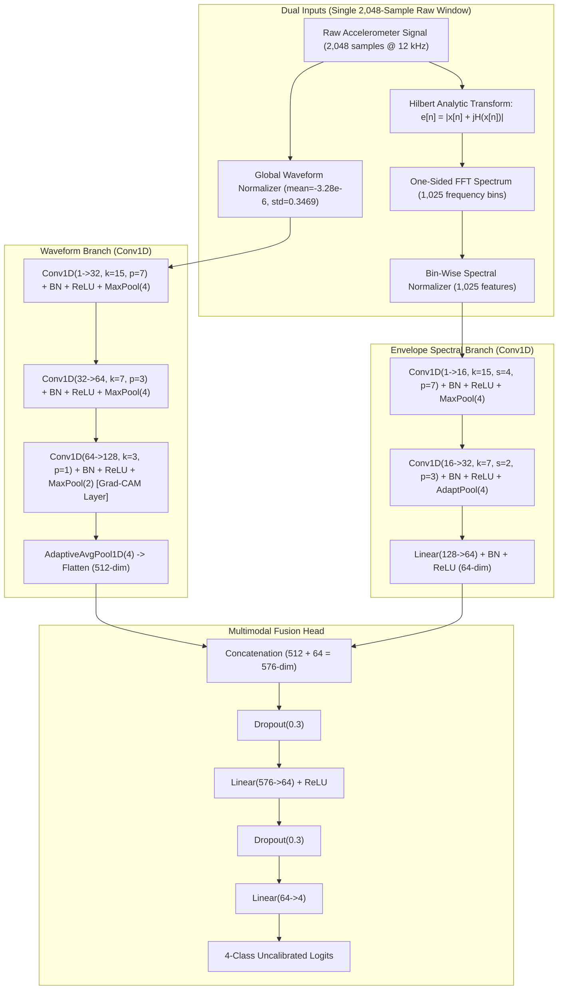

# InspectAI — Final Model Card: SpectralFusionCNN

**Model Name**: InspectAI SpectralFusionCNN  
**Model Version**: `1.0-final` (Frozen Release)  
**Release Date**: November 2026  
**License**: Industrial Diagnostic Research & Deployment  
**Framework**: PyTorch 2.6.0+cpu  

---

## 1. Model Architecture & Parameters

InspectAI `SpectralFusionCNN` is a dual-branch convolutional neural network fusing time-domain acceleration transients with frequency-domain Hilbert analytic envelope spectra.

* **Total Trainable Parameters**: **89,604**
* **Inference Device**: CPU (optimized for edge and server deployment)
* **Single-Window Latency**: Median = **2.56 ms** ($p95 = 4.22$ ms) on standard x86 CPU
* **Throughput**: ~**390 windows/second** (single CPU core, including envelope feature extraction)

---

## 2. Checksum Verification & Artifact Provenance

All release files are located in `models/final/`:

| Artifact | File Name | Size (Bytes) | SHA256 Checksum |
|---|---|:---:|---|
| **Model Weights** | `inspectai_final_model.pth` | 376,857 | `a612eb9ebcc758dccfdc1bf9c56baefb72b9a7698a28795fcb415a9a4b087f94` |
| **Waveform Normalizer** | `inspectai_final_normalizer.json` | 194 | `94ba0b5220c326e5e01f2f0514193d5b5db30c30a8c2f1f54a83a0ca340624d7` |
| **Spectral Normalizer** | `inspectai_final_spectral_normalizer.json` | 56,495 | `2703923bb6eb2ae367305d2146979e5eb21df0c9be06a6c429ea3e4303dfb375` |
| **Model Configuration** | `inspectai_final_config.json` | 2,532 | `5d376ca6aaec895fa2161f3a20760f3dbe858a7beaa23fc471d47155e8bc8c4c` |
| **Machine Model Card** | `inspectai_model_card.json` | 3,011 | `15e8ba9ee8654c86aa956276b51eb3be434f0c608f6eb25b682337b51e5cf586` |

---

## 3. Training Provenance & Data Hygiene

* **Training Dataset**: Case Western Reserve University (CWRU) 12 kHz Drive-End Accelerometer Dataset.
* **Eligible Development Set**: Exactly **36 authentic recordings** across 0 HP, 1 HP, 2 HP, and 3 HP.
* **Total Training Windows**: **8,448 windows** (window length: 2,048 samples; hop size: 512 samples).
* **Permanently Quarantined Historical Holdouts**: `97`, `169`, `185`, `197` (zero exposure during training, normalization, or tuning).
* **Training Hyperparameters**:
  - Epochs: 10 (derived from LOLO inner-validation convergence: mean best epoch = 9.7).
  - Batch size: 32.
  - Optimizer: AdamW ($\text{LR} = 0.0005$, $\text{weight decay} = 0.0001$).
  - Loss: Class-Weighted CrossEntropyLoss ($\text{Normal} = 3.017$, $\text{Faults} \approx 0.818$).
  - Random seed: 42 (deterministic).
  - Training hardware: CPU (completed in 108.53 seconds).

---

## 4. Benchmark Performance Summary

> [!IMPORTANT]
> **Distinction Between Evaluation Benchmarks and Final Model Training**:
> The metrics below reflect the rigorous **3-Fold Leave-One-Load-Out (LOLO)** cross-validation benchmark on unseen held-out motor loads (evaluated across 7,038 windows from 30 independent held-out recording instances). The final frozen release model was subsequently trained on all 36 development recordings.

### Cross-Load Generalization Performance
* **Fold 1 (Held-out 1 HP, 1,772 RPM)**: **100.00% Accuracy**, **100.00% Macro-F1** (0 errors / 2,348 windows).
* **Fold 2 (Held-out 2 HP, 1,750 RPM)**: **99.32% Accuracy**, **99.43% Macro-F1** (16 errors / 2,342 windows).
* **Fold 3 (Held-out 3 HP, 1,725 RPM)**: **100.00% Accuracy**, **100.00% Macro-F1** (0 errors / 2,348 windows).
* **Pooled Cross-Load Macro-F1**: **99.81%**
* **Pooled Accuracy**: **99.77%** (only 16 errors across 7,038 total evaluated windows).
* **Recording 172.mat Accuracy**: **100.00% (234/234 correct, 0 errors)** (improved from 67.09% in the baseline 1D CNN).

### Per-Class Performance (Pooled)
* **Normal**: 100.00% Precision, 100.00% Recall, **100.00% F1** (0 errors).
* **Ball Fault**: 99.30% Precision, 100.00% Recall, **99.65% F1**.
* **Inner Race Fault**: 100.00% Precision, 99.41% Recall, **99.70% F1**.
* **Outer Race Fault**: 99.77% Precision, 100.00% Recall, **99.89% F1**.

---

## 5. Ethical, Physical & Operational Limitations

1. **Test Rig Boundary**: The model is trained and validated on the CWRU motor-driven bearing test stand. Domain adaptation or fine-tuning is required before deploying on field equipment with different housing stiffnesses, gearboxes, or speed regimes.
2. **Active vs. Incipient Damage**: The model identifies active mechanical fault signatures (surface spalling / brinelling); it does not forecast Remaining Useful Life (RUL) or predict incipient subsurface fatigue prior to micro-cracking.
3. **Unmodeled Fault Modes**: The network discriminates four classes (Normal, Ball, Inner Race, Outer Race). Unmodeled operational anomalies (e.g., severe shaft misalignment, structural looseness, electrical fluting, cage fracture) may trigger uncertain or nearest-neighbor classification.
4. **Softmax Output Nature**: Output probabilities are uncalibrated softmax scores reflecting internal feature attribution, not true Bayesian posterior failure probabilities.

