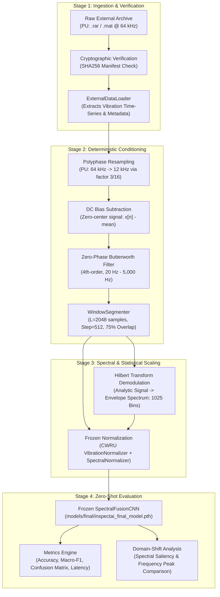

# InspectAI – Phase 13: Leakage-Safe External Validation Protocol

**Date**: November 2026  
**Auditor**: InspectAI Release & Validation Engineering  
**Primary Benchmark Target**: Paderborn University (PU) Bearing Dataset (SKF 6203, 1500 RPM, 64 kHz)  
**Secondary Restricted Target**: MFPT Bearing Dataset (Nice #1012, 1000 RPM, 3-Class Restricted)

---

## 1. Scientific Objective & Boundaries

The objective of Phase 13 is to establish an empirical, leakage-safe protocol for testing whether InspectAI's frozen release model (`SpectralFusionCNN`, 89,604 parameters) generalizes zero-shot to an entirely independent bearing test rig.

### Strict Methodological Boundaries
1. **Zero Weight Modification**: Under no circumstances will `models/final/inspectai_final_model.pth` or `models/checkpoints/inspectai_final_cnn.pth` be retrained, fine-tuned, or adapted during external evaluation.
2. **Zero In-Sample Normalization**: Neither `VibrationNormalizer` nor `SpectralNormalizer` will be fitted on external dataset windows. The frozen normalizers ($\mu = -3.2797\times 10^{-6}, \sigma = 0.3469$ for waveforms; feature-wise statistics for spectral bins) derived exclusively from the 36 CWRU development recordings must be applied.
3. **No Threshold Tuning**: Classification decisions will be computed using the standard $\arg\max_c p_c$ operator without tuning probability decision thresholds on external test data.
4. **Permanent Isolation of CWRU Holdouts**: Historical CWRU holdouts (`97`, `169`, `185`, `197`) will remain permanently excluded and will not be conflated with external validation.

---

## 2. Experimental Stages & Evaluation Design

The external validation pipeline comprises four distinct analytical stages:

---

## 3. Stage A: Zero-Shot External Evaluation Protocol

### 3.1 Input Tensor Contract
The external data pipeline must strictly satisfy InspectAI's input tensor shape and numerical range requirements:
1. **Waveform Tensor**:
   - Shape: $(B, 1, 2048)$, dtype `torch.float32`.
   - Duration: $\approx 170.67\text{ ms}$ at 12,000 Hz.
   - Scaled using frozen `VibrationNormalizer`: $z[n] = \frac{x[n] - \mu_{\text{CWRU}}}{\sigma_{\text{CWRU}}}$.
2. **Envelope Spectrum Tensor**:
   - Shape: $(B, 1, 1025)$, dtype `torch.float32`.
   - Bins: 1,025 positive frequency bins from $0\text{ Hz}$ to $6,000\text{ Hz}$ ($\Delta f \approx 5.859\text{ Hz/bin}$).
   - Scaled using frozen `SpectralNormalizer`: $\tilde{S}[k] = \frac{S[k] - \mu_{\text{CWRU}}[k]}{\sigma_{\text{CWRU}}[k] + \epsilon}$.

### 3.2 Signal Unit Conversion
- Paderborn signals are recorded in $\text{m/s}^2$.
- CWRU signals were recorded in gravitational units ($g$).
- **Conversion Rule**: Accelerations must be converted prior to normalizer scaling:
  $$x_g[n] = \frac{x_{\text{m/s}^2}[n]}{9.80665}$$

### 3.3 Sampling Rate Conversion
- Paderborn signals are sampled at $64,000\text{ Hz}$.
- Target sampling rate is $12,000\text{ Hz}$.
- Ratio: $\frac{12000}{64000} = \frac{3}{16} = 0.1875$.
- **Method**: Anti-aliased polyphase rational resampling via `scipy.signal.resample_poly(x, up=3, down=16)` with an 8th-order Chebyshev lowpass filter to prevent spectral folding above 6,000 Hz.

---

## 4. Stage B: Recording-Level Group Separation

To avoid data leakage during zero-shot benchmarking:
1. **Strict Bearing-Level Isolation**:
   Windows generated from bearing `K001` or `KA01` will never be pooled with windows from other runs for threshold selection.
2. **Separate Manifest Partitioning**:
   Every external recording is assigned an explicit external identifier format:
   `EXT_<DATASET>_<BEARING_ID>_<CONDITION>_<RUN>` (e.g. `EXT_PU_KA01_N15M07F10_1`).
   External IDs will never collide with CWRU IDs (`97`–`237`).

---

## 5. Stage C: Domain-Shift & Physical Failure Analysis

External evaluation must explicitly measure and report four domain-shift parameters:

1. **Shaft Speed Discrepancy**:
   - CWRU operates at ~1772 RPM ($29.5\text{ Hz}$).
   - Paderborn operates at 1500 RPM ($25.0\text{ Hz}$) — an operating speed reduction of $15.3\%$.
   - **Hypothesis**: The physical impact repetition period will stretch by $\approx 18\%$. The model's temporal convolutional filters will observe wider spacing between peaks.
2. **Harmonic Peak Transposition**:
   - Inner Race BPFI: shifts from $159.8\text{ Hz}$ (bin 27) down to $123.7\text{ Hz}$ (bin 21).
   - Outer Race BPFO: shifts from $105.8\text{ Hz}$ (bin 18) down to $76.3\text{ Hz}$ (bin 13).
   - Ball Fault BSF: shifts from $69.5\text{ Hz}$ (bin 12) down to $49.8\text{ Hz}$ (bin 9).
3. **Rig Structural Resonance & Transfer Function**:
   - The acoustic transfer function of Paderborn's test stand differs from Reliance Electric's motor housing.
   - Resonances in Paderborn typically cluster around $3.5\text{ kHz}$ to $4.5\text{ kHz}$.
4. **Fault Generation Morphology**:
   - CWRU: EDM notches with depths of $0.007''$ to $0.021''$.
   - Paderborn: Both EDM slots (0.25 mm) and real fatigue spalls created by accelerated lifetime running.

---

## 6. Stage D: Evaluation Metrics & Reporting Standard

For all evaluated external subsets, the benchmark runner will report:
- **Accuracy**: Overall and balanced accuracy across valid classes.
- **Macro Precision, Recall, and Macro-F1**: Equal weight across classes.
- **Confusion Matrix**: Visualizing cross-class confusion (e.g. Inner Race predicted as Outer Race).
- **Softmax Confidence Distribution**: Histogram of maximum softmax probability $\max_c p_c$, highlighting whether predictions are confident or diffuse.
- **1D Grad-CAM Saliency Attribution**: Measuring whether model attention aligns with external kinematic impact intervals or diffuses across noise.
- **CPU Inference Latency**: Benchmarking median and p95 latency per external window.

---

## 7. Restricted 3-Class Benchmark Protocol (For Datasets Lacking Ball Faults)

When benchmarking against datasets that lack rolling element faults (such as the MFPT dataset):
- **Protocol**: The model will be evaluated exclusively on the 3 common classes: `Normal`, `Inner Race Fault`, and `Outer Race Fault`.
- **Handling Ball Fault Logit**: The Ball Fault logit ($y_1$) will **not** be artificially suppressed or deleted.
- If the model predicts Ball Fault on an external Inner or Outer race recording, it will be classified as an error (false positive for Ball, false negative for true fault).
- This ensures rigorous zero-shot transparency without cherry-picking.
