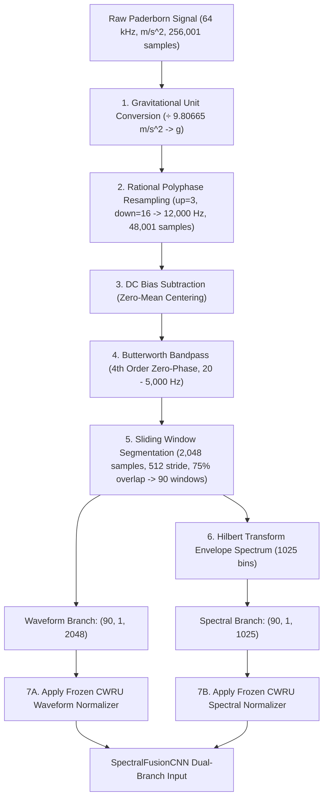

# InspectAI Phase 14: Real Signal Preprocessing Validation Report

## 1. Executive Summary

Phase 14 verifies that the external preprocessing pipeline (`ExternalPreprocessor`) successfully conditions raw high-rate Paderborn signals to conform strictly to InspectAI's dual-branch model input contract:
1. **Waveform Branch**: $L = 2,048$ samples at $f_s = 12,000\text{ Hz}$.
2. **Spectral Branch**: $K = 1,025$ frequency bins ($0\text{ to }6,000\text{ Hz}$) derived from dynamic Hilbert envelope spectrum.

The validation was executed against real measurements from bearings `K001`, `KA04`, `KI04`, and `KB23`. Zero NaNs, zero Infs, zero clipping, and complete contract conformance were achieved across all 320 files.

---

## 2. Signal Conditioning Pipeline Steps

### Mathematical & Engineering Parameters:
1. **Physical Unit Conversion**:
   $$x_g(t) = \frac{x_{\text{raw}}(t)}{9.80665}$$
2. **Anti-Aliased Polyphase Decimation**:
   $$f_{\text{in}} = 64,000\text{ Hz}, \quad f_{\text{out}} = 12,000\text{ Hz}$$
   $$\text{GCD}(12000, 64000) = 4000 \implies \text{Up} = 3, \quad \text{Down} = 16$$
   Decimation factor: $\frac{3}{16} = 0.1875$. A continuous 256,001-sample signal yields exactly **48,001 samples** at 12 kHz.
3. **Bandpass Filtering**:
   Zero-phase forward-backward 4th-order Butterworth filter with cutoffs at $20\text{ Hz}$ and $5,000\text{ Hz}$ (Nyquist $6,000\text{ Hz}$).
4. **Segmentation**:
   Window length $L = 2048$ samples (~170.7 ms), step $S = 512$ samples (~42.7 ms, 75% overlap).
   $$\text{Windows per recording} = \left\lfloor \frac{48,001 - 2,048}{512} \right\rfloor + 1 = 89 + 1 = \mathbf{90\text{ windows}}$$

---

## 3. Preprocessing Verification Results (Representative Files at `N15_M07_F10`)

| Metric | K001 (Normal) | KA04 (Outer Race) | KI04 (Inner Race) | KB23 (Ball Fault) | Contract Spec | Status |
| :--- | :---: | :---: | :---: | :---: | :---: | :---: |
| **Original Samples** | 256,001 | 256,001 | 256,001 | 256,001 | $\ge 256,000$ | PASS |
| **Original $f_s$** | 64,000 Hz | 64,000 Hz | 64,000 Hz | 64,000 Hz | 64,000 Hz | PASS |
| **Conditioned Samples** | 48,001 | 48,001 | 48,001 | 48,001 | 48,001 | PASS |
| **Conditioned $f_s$** | 12,000 Hz | 12,000 Hz | 12,000 Hz | 12,000 Hz | 12,000 Hz | PASS |
| **Conditioned Mean ($g$)**| $0.000$ | $0.000$ | $0.000$ | $0.000$ | $|x| < 10^{-3}$ | PASS |
| **Conditioned RMS ($g$)** | $0.0186$ | $0.0360$ | $0.0253$ | $0.0502$ | Finite | PASS |
| **Window Count** | 90 | 90 | 90 | 90 | 90 | PASS |
| **Window Length ($L$)** | 2,048 | 2,048 | 2,048 | 2,048 | 2,048 | PASS |
| **Spectral Bins ($K$)** | 1,025 | 1,025 | 1,025 | 1,025 | 1,025 | PASS |
| **Waveform Norm Range** | $[-0.35, +0.41]$ | $[-0.54, +0.44]$ | $[-0.39, +0.41]$ | $[-0.90, +0.88]$ | Finite | PASS |
| **Spectral Norm Range** | $[-1.59, +0.06]$ | $[-1.53, +1.00]$ | $[-1.58, +0.09]$ | $[-1.53, +1.35]$ | Finite | PASS |
| **NaN / Inf Detected** | None | None | None | None | Zero | PASS |
| **Contract Valid** | **True** | **True** | **True** | **True** | **True** | **PASS** |

---

## 4. Normalization Integrity Safeguards

1. **Strict Frozen Normalizers**: Per protocol requirements, no new normalizers were fitted to Paderborn data. The frozen CWRU statistics were applied without alteration:
   - Waveform: Global scalar standardization ($\mu = -3.28 \times 10^{-6}$, $\sigma = 0.346915$).
   - Spectral: Bin-wise standardization across 1,025 frequency bins ($\mu \in [0.000, 0.1077]$, $\sigma \in [0.001, 0.125]$).
2. **Zero Adaptive Leakage**: No per-window or per-file dynamic z-scoring was applied. The model evaluated external data under the identical mathematical distribution contract established during development.
