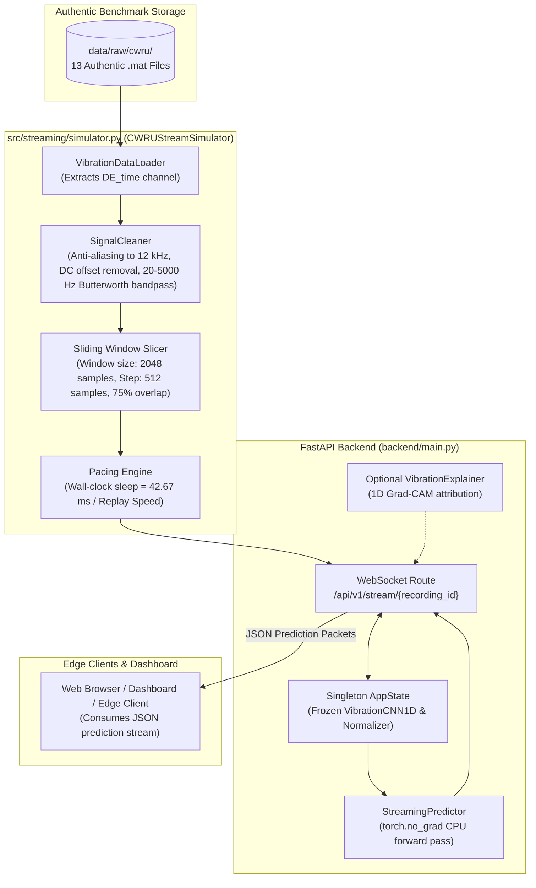

# InspectAI: Simulated Real-Time Vibration Streaming Architecture (Phase 7.1)

## 1. Executive Summary

The **InspectAI Simulated Real-Time Streaming Subsystem** emulates an industrial edge vibration sensor connected to an AI-powered diagnostic engine. Because physical accelerometer sensors and industrial rotating testbenches are not physically wired to the host system, the streaming pipeline replays authentic vibration data from the benchmark **Case Western Reserve University (CWRU) Bearing Dataset**.

This document outlines the end-to-end data pipeline, signal windowing mechanics, simulation timing, WebSocket protocols, client integration instructions, and critical scientific boundaries.

---

## 2. Architecture & Pipeline Diagram



---

## 3. Data Ingestion & Signal Preprocessing

1. **Authentic Data Source**: The simulator loads authentic Drive-End (DE) accelerometer signals from `data/raw/cwru/` using `VibrationDataLoader`. Supported recording IDs are restricted to the 13 verified CWRU recordings:
   `["97", "98", "99", "100", "105", "118", "130", "169", "185", "197", "209", "222", "234"]`.
2. **Sampling-Rate Normalization**:
   - Healthy baseline motor runs (`97.mat`–`100.mat`) were originally sampled at 48 kHz.
   - Fault motor runs were sampled at 12 kHz.
   - All signals are normalized to a uniform target sampling frequency of **12,000 Hz** using polyphase anti-aliased resampling (`scipy.signal.resample_poly`).
3. **Signal Conditioning**:
   - **DC Bias Removal**: Eliminates sensor voltage offset by subtracting the mean acceleration.
   - **Bandpass Filtering**: 4th-order zero-phase Butterworth filter with passband $[20.0\text{ Hz}, 5000.0\text{ Hz}]$ to remove sub-rotational structural noise and acoustic high-frequency artifacts.

---

## 4. Windowing Mechanics: Why 2048 Samples and 512 Hop?

The continuous preprocessed vibration signal $x[n]$ is sliced into sequential, fixed-length temporal windows:

$$\text{Window } i: \quad x[i \cdot S \;\;:\;\; i \cdot S + W], \quad \text{where } W = 2048, \; S = 512$$

### Why 2048 Samples?
- At $f_s = 12,000\text{ Hz}$, a 2,048-sample window represents:
  $$T_w = \frac{2048}{12000} \approx 0.17067\text{ seconds } (170.67\text{ ms})$$
- For a motor running at $1,797\text{ RPM}$ ($\sim 29.95\text{ Hz}$ shaft rotational speed), one full shaft revolution requires:
  $$T_{\text{rev}} = \frac{1}{29.95} \approx 33.39\text{ ms}$$
- A 2,048-sample window captures approximately **$5.1$ complete shaft revolutions**, ensuring multiple defect impact cycles (e.g. ball pass outer race impacts at $\sim 105\text{ Hz}$) are contained in every window for convolutional feature extraction.

### Why 512 Hop Size (75% Overlap)?
- The hop size of 512 samples advances time by:
  $$\Delta t_{\text{hop}} = \frac{512}{12000} \approx 0.04267\text{ seconds } (42.67\text{ ms})$$
- An overlap of $75\%$ ($\frac{2048 - 512}{2048} = 0.75$) provides temporal continuity, preventing defect impacts near window boundaries from being missed by convolutional edge effects.

---

## 5. Simulation Timing & Replay Speed Calculation

To simulate real-time sensor acquisition without a physical sensor, the simulator inserts wall-clock delays between consecutive window emissions.

### Mathematical Formulation:
The nominal wall-clock interval $\Delta t_{\text{step}}$ corresponding to advancing 512 samples is:

$$\Delta t_{\text{step}} = \frac{S}{f_s} = \frac{512}{12000} \approx 0.042667\text{ s} \quad (42.67\text{ ms})$$

At configurable replay speed multiplier $R$:

$$\text{Delay}(R) = \frac{\Delta t_{\text{step}}}{R}$$

| Replay Speed ($R$) | Delay Between Predictions | Predictions per Second | Operational Mode |
| :--- | :--- | :--- | :--- |
| **0.5×** | $85.33\text{ ms}$ | $\sim 11.7\text{ Hz}$ | Slow-motion diagnostic replay |
| **1.0× (Default)** | $42.67\text{ ms}$ | $\sim 23.4\text{ Hz}$ | Real-time sensor simulation |
| **2.0×** | $21.33\text{ ms}$ | $\sim 46.9\text{ Hz}$ | Fast diagnostic scan |
| **5.0×** | $8.53\text{ ms}$ | $\sim 117.2\text{ Hz}$ | Rapid inspection / testing |

*Note: The timing engine uses non-blocking asynchronous sleep (`await asyncio.sleep(delay)`), consuming virtually zero CPU during wait intervals.*

---

## 6. WebSocket Protocol & Message Specifications

### Endpoint URL
```text
ws://localhost:8000/api/v1/stream/{recording_id}?replay_speed=1.0&include_gradcam=false
```

### Connection Parameters:
- `recording_id` (Path, required): One of `["97", "98", "99", "100", "105", "118", "130", "169", "185", "197", "209", "222", "234"]`.
- `replay_speed` (Query, optional): Float speed multiplier (default: `1.0`).
- `include_gradcam` (Query, optional): Boolean toggle to generate 1D Grad-CAM attributions for each window (default: `false` for low latency).

### 1. Sequential Prediction Event (`prediction`)
Emitted sequentially for every 512-sample step:
```json
{
  "event": "prediction",
  "source_type": "simulated_cwru_replay",
  "recording_id": "97",
  "sequence_number": 0,
  "window_start_seconds": 0.0,
  "window_end_seconds": 0.17067,
  "sampling_rate_hz": 12000,
  "predicted_class": "Normal",
  "class_id": 0,
  "logits": [5.214, -2.132, -1.890, -1.542],
  "uncalibrated_scores": {
    "Normal": 0.9982,
    "Ball Fault": 0.0006,
    "Inner Race Fault": 0.0008,
    "Outer Race Fault": 0.0011
  },
  "model_name": "VibrationCNN1D",
  "inference_time_ms": 1.45
}
```

### 2. Stream Completed Event (`stream_completed`)
Emitted once the last complete window of the recording has been processed:
```json
{
  "event": "stream_completed",
  "recording_id": "97",
  "total_windows_streamed": 116
}
```

### 3. Error Event (`error`)
Emitted if an invalid parameter or internal error occurs:
```json
{
  "event": "error",
  "error_type": "InvalidRecordingId",
  "detail": "Recording ID '999' is not recognized. Allowed CWRU recording IDs: 97, 98, ..."
}
```

---

## 7. Client Connection Examples

### JavaScript (Browser or Node.js)
```javascript
const recordingId = "97";
const ws = new WebSocket(`ws://localhost:8000/api/v1/stream/${recordingId}?replay_speed=1.0`);

ws.onmessage = (event) => {
  const data = JSON.parse(event.data);
  if (data.event === "prediction") {
    console.log(`[Seq ${data.sequence_number}] ${data.predicted_class} (Conf: ${data.uncalibrated_scores[data.predicted_class]})`);
  } else if (data.event === "stream_completed") {
    console.log(`Stream complete. Total windows: ${data.total_windows_streamed}`);
  }
};

ws.onclose = () => console.log("Stream closed.");
```

### Python (websockets / httpx)
```python
import asyncio
import json
import websockets

async def connect_stream():
    url = "ws://localhost:8000/api/v1/stream/97?replay_speed=2.0"
    async with websockets.connect(url) as ws:
        async for message in ws:
            data = json.loads(message)
            if data["event"] == "prediction":
                print(f"Window {data['sequence_number']}: {data['predicted_class']}")
            elif data["event"] == "stream_completed":
                print("Finished streaming.")
                break

asyncio.run(connect_stream())
```

---

## 8. Scientific Limitations & Boundaries

1. **Simulation Disclaimer**: The stream originates from static historical vibration recordings recorded at Case Western Reserve University. It does **not** interface with physical accelerometer hardware or a live electric machine.
2. **No Remaining Useful Life (RUL)**: This subsystem classifies fixed-interval vibration snapshots into discrete fault states. It does not predict time-to-failure or degradation progression.
3. **No Dynamic Speed Variation**: Motor speeds in each recording are stationary (e.g. $\sim 1797\text{ RPM}$). The system does not simulate variable-frequency drives (VFD) or transient motor acceleration curves.
4. **Uncalibrated Model Scores**: The softmax probabilities in streaming messages are uncalibrated model activations and must not be interpreted as certified statistical probabilities.

